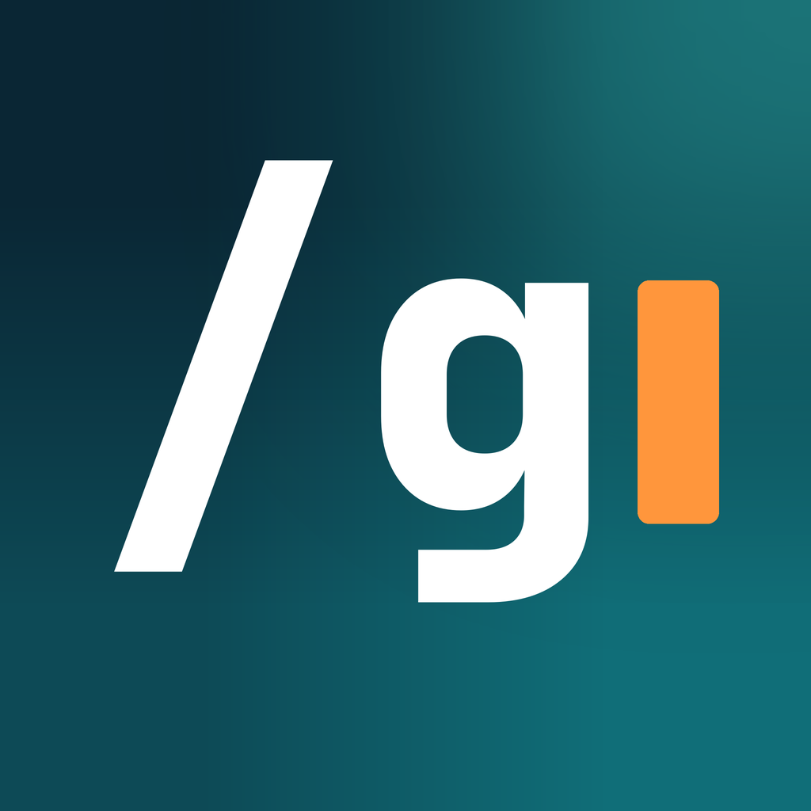

gelo has an icon now: a white `/g` with an orange cursor on teal.



## What's new
- **Plugin icon** (`plugins/roblox-studio/.claude-plugin/icon.png`, 1024×1024). Claude Code shows it, and it is ready for the plugin directory. The plugin now passes `claude plugin validate` with no warnings.
- **`gelo-icon.png` in the release** and in the ChatGPT pack. Use it as the profile picture of your gelo Custom GPT; `START-HERE.md` says where.

Everything from [v0.10.0](https://github.com/G3LO1/gelo/releases/tag/v0.10.0) still applies: `/gelo` and `@gelo` in Claude Code, ChatGPT, Codex, Gemini and any LLM, plus the MIT license.

## Downloads
| File | For |
| --- | --- |
| `gelo-chatgpt-pack-v0.10.1.zip` | **ChatGPT Custom GPT** (then `@gelo` in any chat), Gemini Gem, Claude.ai Project. Unzip and follow `START-HERE.md`. |
| `gelo-full-v0.10.1.md` | Any LLM with a large context: use it as the system prompt. |
| `gelo-skills-v0.10.1.zip` | The skill folders, for `.claude/skills/` or `.agents/skills/`. |
| `gelo-icon.png` | The icon, e.g. for the Custom GPT profile picture. |

## Update
```
/plugin update roblox-studio
```
